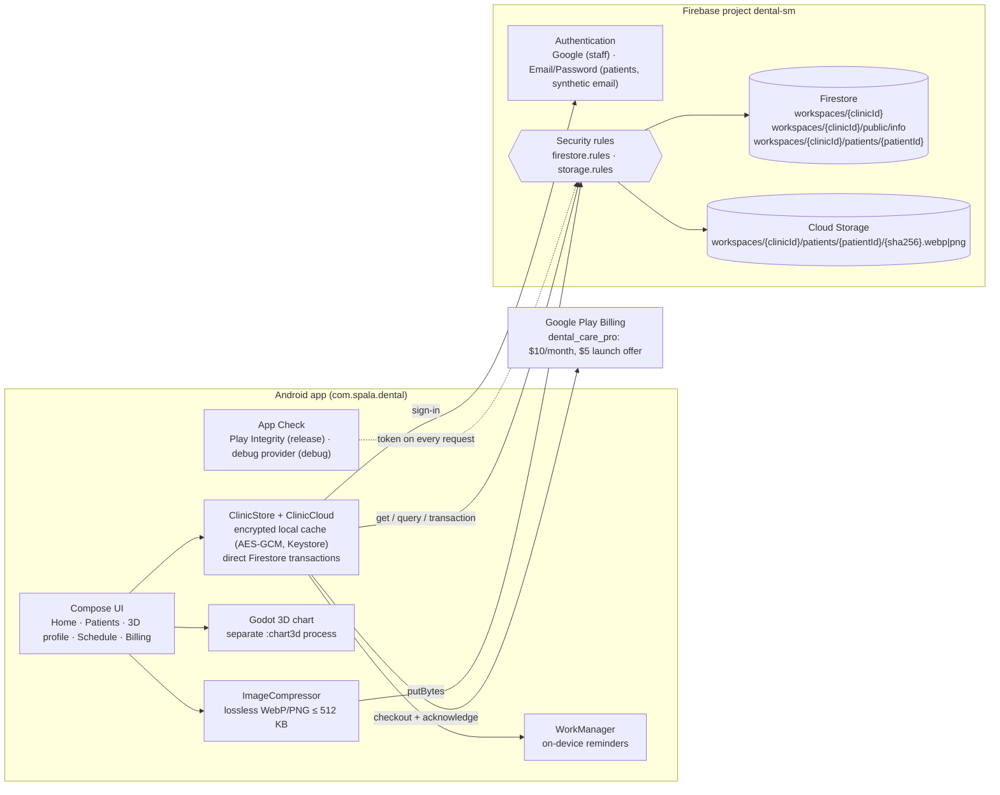
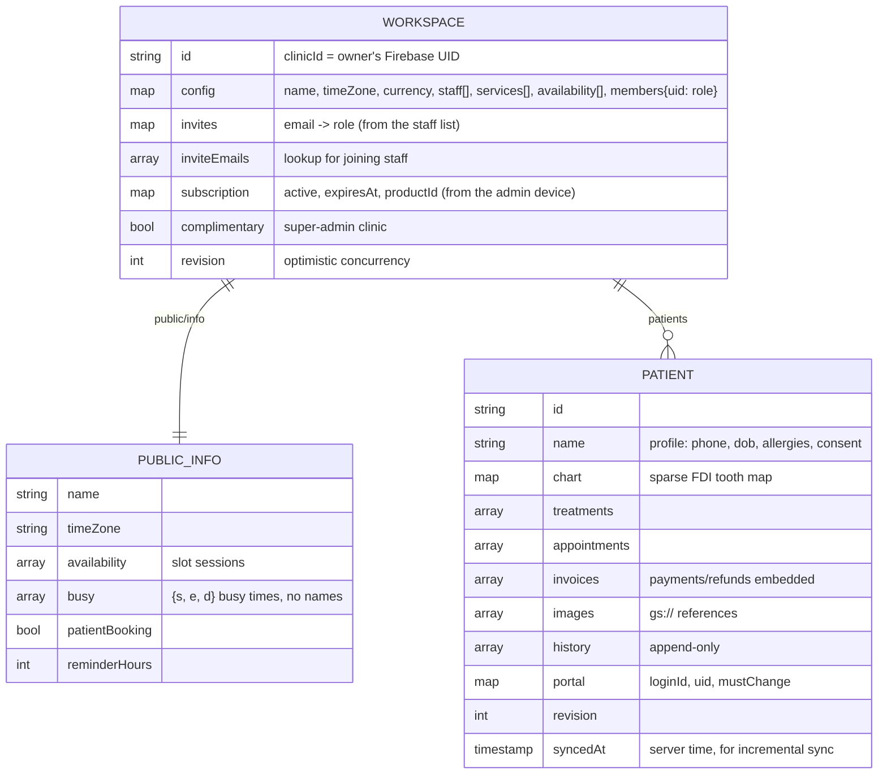
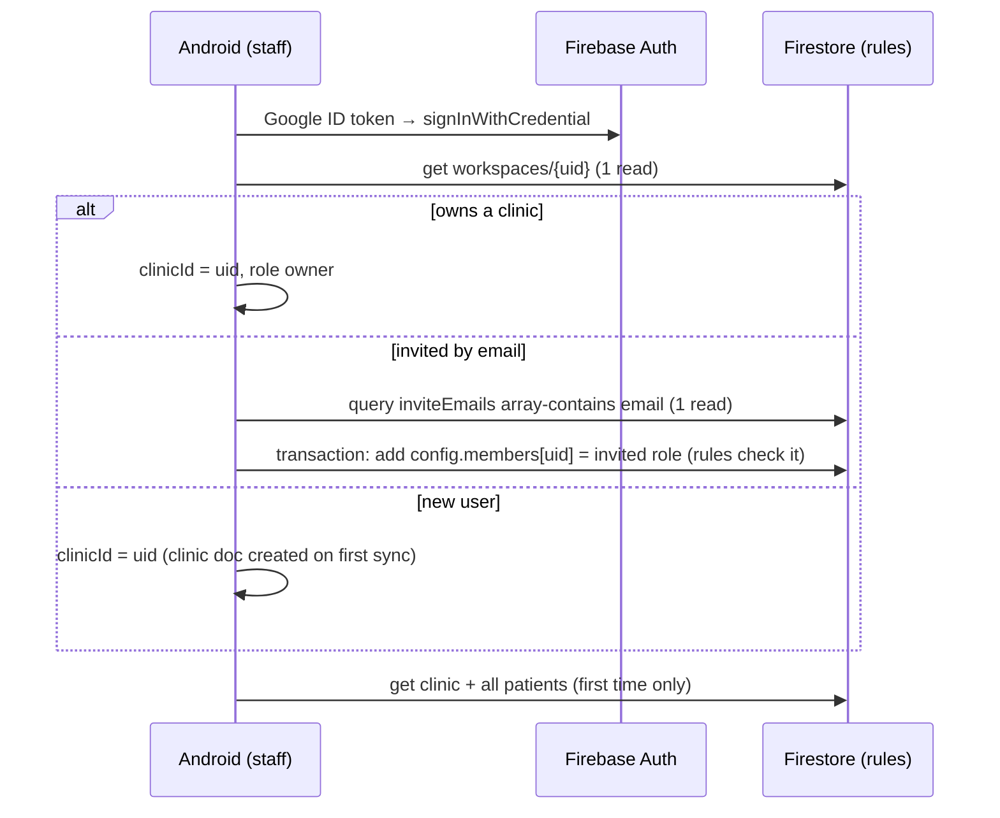
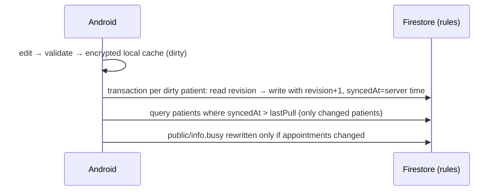
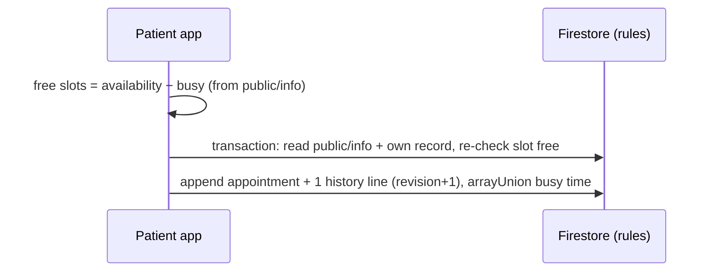

# Dental Care · Firebase architecture

Firebase holds all clinic data:
- **Firestore:** patients, staff/doctors, clinic settings, appointments, billing and treatment history.
- **Cloud Storage:** clinical images.
- **Firebase Authentication:** Google sign-in for the clinic team, and Patient ID + password for patients.
- **App Check (Play Integrity):** only the genuine app from Google Play can call Firebase.

There are **no Cloud Functions**. The Android app reads and writes Firestore directly. Security
rules decide who may read or change what. The design keeps documents, reads and writes small:
- two documents per clinic (settings + patient-visible info) and one per patient
- every list (staff, members, availability, appointments, treatments, invoices, history) is embedded
- no listeners or polling; incremental sync reads only patients that changed

## 1. System overview



## 2. Firestore data model (three document kinds)



- **Why one document per patient, not one for all?** Rules protect whole documents. A patient who can
  read a shared list document would see every other patient in it, and one document holds at most 1 MiB.
- **Patient logins** are Firebase Auth accounts; the patient document's `portal.uid` links them, so no
  login or index documents are needed.
- **Large arrays and maps are exempt from indexing.** Only `inviteEmails`, `syncedAt` and
  `portal.uid` (collection group) are queried.

## 3. Key flows

### Staff sign-in (Google) and joining a clinic



### Patient login created on the admin's phone

```mermaid
sequenceDiagram
  participant Ad as Admin app
  participant Auth2 as Firebase Auth (sign-up endpoint)
  participant DB as Firestore (rules)
  participant P as Patient app
  Ad->>Auth2: accounts:signUp(ID@patient.dentalcare.local, password chosen by admin) + App Check token
  Note over Ad,Auth2: nobody is signed in on the admin's phone; the admin stays signed in
  Ad->>DB: transaction: patient.portal = {loginId, uid, mustChange: true}
  Ad-->>Ad: Patient ID + password shown once → share
  P->>DB: signIn, then collectionGroup('patients').where('portal.uid','==',uid) (1 read)
  P->>P: forced "Choose your password" (reauthenticate + updatePassword)
  P->>DB: portal.mustChange = false
  P->>DB: read own record + public/info (2 reads), schedule reminders on the phone
  Note over Ad,DB: Reset = new Patient ID + password chosen by the admin; the old ID loses access
```

### Save and sync (offline-first, incremental)



### Patient booking



## 4. Cost controls

| Area | Choice | Effect |
|---|---|---|
| Server | No Cloud Functions, Scheduler or FCM sends | No compute bill; Spark plan is enough until Firestore/Storage quotas |
| Documents | 2 per clinic + 1 per patient; every list embedded | Fewest documents; opening a patient is 0 cloud reads (local cache) |
| Sync | Write dirty patients; read `syncedAt > lastPull` | Routine sync reads only changed patients |
| Listeners | None | No continuous read charges |
| Indexes | Large fields exempt; 3 queried fields | Lower index storage and write cost |
| Patient logins | Auth accounts linked by `portal.uid` | No login documents |
| Images | Lossless WebP ≤ 512 KB, SHA-256 names (deduplicated), private refs | Small storage and egress, no duplicate uploads |
| Reminders | WorkManager on each phone | No scheduled jobs, no push costs |
| Subscription | Play purchase acknowledged on the device; entitlement on the clinic doc | No Play API calls or extra documents |

## 5. Security

- **App Check** (Play Integrity) blocks requests that don't come from the genuine app once enforced.
- **Firestore rules:** clinic membership and roles come from the clinic document; writes need the next
  revision; field groups (clinical, invoices, patient login) need the right role; patients can only
  read their own record and book/cancel.
- **Storage rules** check clinic membership through `firestore.get`. Images are capped at 512 KB and
  must be PNG or WebP.
- **Patient emails** are synthetic, so no email is ever sent. Password recovery is an admin reset that
  issues a new Patient ID.
- See BACKEND_SETUP.md › "Limits of a server-less design" for what rules cannot enforce.
