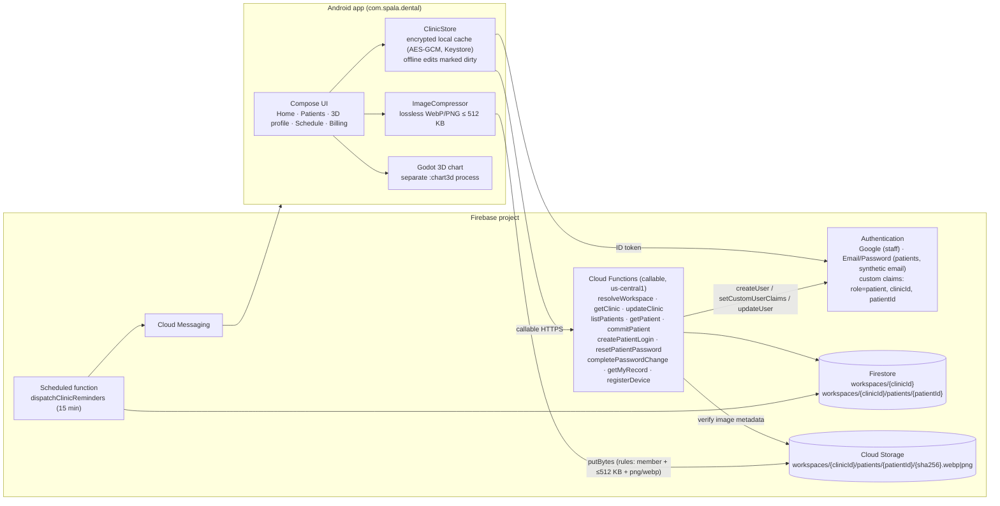
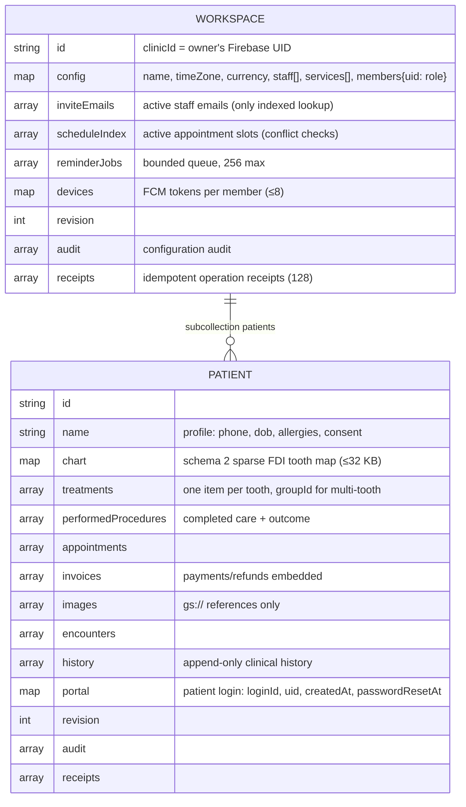
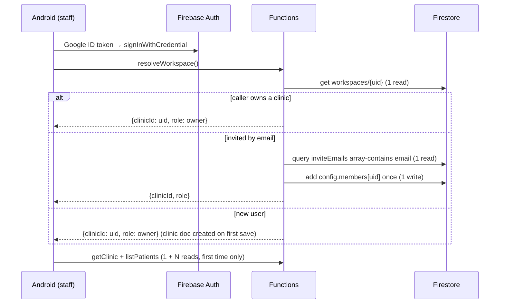
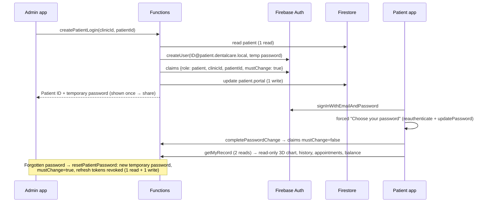
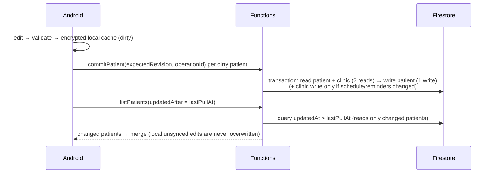
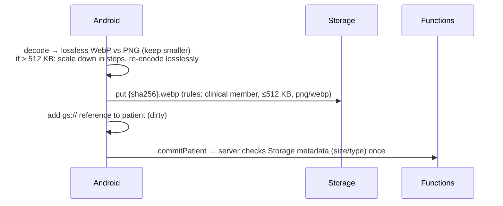

# Dental Care · Firebase architecture

Firebase holds all clinic data:
- **Firestore:** patients, staff/doctors, clinic settings, appointments, billing and treatment history.
- **Cloud Storage:** clinical images.
- **Firebase Authentication:** Google sign-in for the clinic team, and Patient ID + password for patients.

The Android app never reads or writes Firestore directly. Every call goes through **callable Cloud Functions**. They enforce roles, validate clinical rules, and return only what the caller may see.

The design is built to **keep the number of documents and reads small**:
- one document per clinic and one per patient
- no subcollections, listeners or polling
- incremental sync that reads only patients that changed

## 1. System overview

## 2. Firestore data model (two document types)

- **Staff and doctors** are entries in `config.staff` inside the clinic document. That means no `staff/` collection, and adding a doctor costs one write.
- **Patient logins** live in Firebase Authentication, not Firestore. Their custom claims say which clinic and patient they belong to. The patient document keeps one small `portal` field.
- **Large arrays and maps are exempt from indexing** (`firestore.indexes.json`), which saves index storage and write cost. Only two lookups are indexed: `inviteEmails`, and `updatedAt` for incremental sync.
- **Hard limit:** a patient document is capped at about 750 KB (Firestore allows 1 MiB). The server refuses writes near the cap rather than truncating history.

## 3. Key flows

### Staff sign-in (Google) and joining a clinic

### Patient login created by the admin, then the patient's first sign-in

### Save and sync (offline-first, incremental)

### Clinical image upload

## 4. Cost controls

| Area | Choice | Effect |
|---|---|---|
| Documents | 1 clinic doc + 1 doc per patient. Staff, appointments, invoices and treatments are embedded. | Few documents, and opening a patient is 1 read |
| Sync | Push only dirty patients, then pull `updatedAt > lastPullAt` | Routine sync reads only changed patients, not the whole clinic |
| Listeners | None (callables on demand) | No continuous read charges |
| Indexes | Large fields exempt; only `inviteEmails`, `updatedAt`, reminder compound index | Lower index storage and write cost |
| Patient logins | Firebase Auth users + custom claims | No Firestore docs per login |
| Images | Lossless WebP ≤ 512 KB, SHA-256 names (deduplicated), private `gs://` refs | Small storage and egress, no duplicate uploads |
| Functions | `maxInstances: 4`, 60 s timeout, no min instances | No idle compute cost |
| Reminders | One due-clinic query every 15 min; jobs embedded in the clinic doc | No per-patient polling |
| Offline cache | Encrypted local copy | Screens read locally; the cloud is touched only on sync |

## 5. Security

- **Firestore rules** deny all direct client access. Only Cloud Functions (Admin SDK) read and write Firestore.
- **Storage rules** check clinic membership through `firestore.get`. Images are capped at 512 KB, and the type must be PNG or WebP.
- **Roles:** owner, admin, dentist, assistant, receptionist, cashier, auditor and patient.
  - Dentists and admins record treatment.
  - Patients see only their own record, read-only, without internal history or audit.
- **Patient emails** are synthetic, so no email is ever sent. Password recovery is an admin reset.
